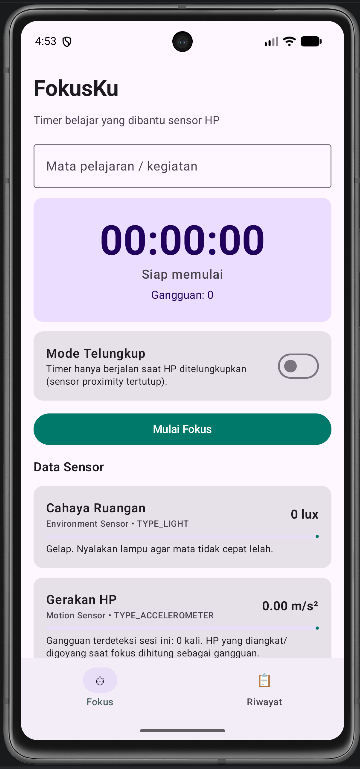
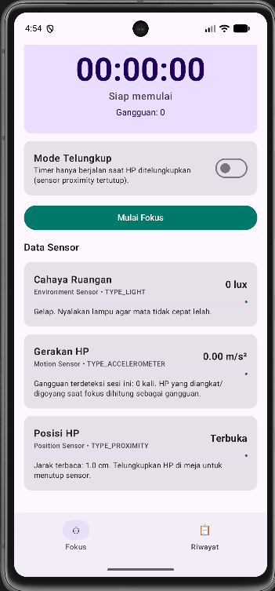
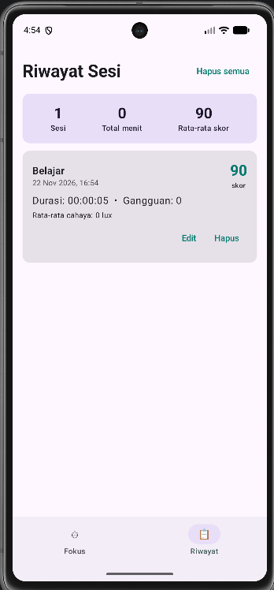

# FokusKu – Timer Belajar Berbasis Sensor

**FokusKu** adalah aplikasi Android untuk membantu pelajar dan mahasiswa belajar lebih fokus. Aplikasi ini menghitung durasi belajar, mendeteksi gangguan saat HP diangkat atau digerakkan, memantau pencahayaan ruangan, dan menyimpan riwayat setiap sesi belajar ke database lokal. Dari data tersebut, aplikasi memberikan **skor fokus** untuk setiap sesi.

Proyek ini dibuat untuk memenuhi **Proyek Akhir Semester Ganjil – Pemrograman Android**.

---

## Fitur Aplikasi

- **Timer fokus**: mulai, jeda, lanjut, batalkan, lalu simpan sesi belajar.
- **Mode Telungkup**: timer hanya berjalan saat HP ditelungkupkan di meja (sensor proximity tertutup). Kalau HP diangkat, timer otomatis berhenti dan gangguan bertambah.
- **Deteksi gangguan**: HP yang digoyang atau diangkat selama sesi berjalan dihitung sebagai gangguan.
- **Monitor cahaya ruangan**: menampilkan intensitas cahaya (lux) beserta saran apakah ruangan terlalu gelap atau terlalu silau untuk belajar.
- **Skor fokus (0–100)**: dihitung dari jumlah gangguan dan rata-rata cahaya selama sesi.
- **Riwayat sesi (CRUD SQLite)**:
  - *Create*: sesi otomatis tersimpan saat menekan **Selesai & Simpan**.
  - *Read*: daftar semua sesi beserta ringkasan (jumlah sesi, total menit, rata-rata skor).
  - *Update*: ubah nama mata pelajaran dan tambahkan catatan.
  - *Delete*: hapus satu sesi atau hapus semua riwayat.

---

## Teknologi dan Arsitektur

| Komponen | Teknologi |
|---|---|
| Bahasa | Kotlin |
| UI | Jetpack Compose + Material 3 |
| Arsitektur | MVVM (Model–View–ViewModel) |
| Database | SQLite (`SQLiteOpenHelper`) |
| State | `StateFlow`, `collectAsStateWithLifecycle` |
| Async | Kotlin Coroutines & Flow |
| Sensor | Android `SensorManager` |

### Struktur MVVM

```
com.example.jetpack
├── data
│   ├── model/FocusSession.kt          # Model data sesi
│   ├── local/FocusDatabaseHelper.kt   # SQLiteOpenHelper (CRUD)
│   └── repository/SessionRepository.kt
├── sensor
│   └── SensorRepository.kt            # SensorManager -> Flow
├── ui
│   ├── viewmodel
│   │   ├── FocusViewModel.kt          # Logika timer + sensor
│   │   ├── HistoryViewModel.kt        # Logika riwayat (CRUD)
│   │   └── AppViewModelProvider.kt    # Factory ViewModel
│   ├── screens
│   │   ├── FocusScreen.kt             # Tampilan timer & data sensor
│   │   └── HistoryScreen.kt           # Tampilan riwayat sesi
│   ├── theme/                         # Warna, tema, tipografi
│   └── FokusKuApp.kt                  # Scaffold + bottom navigation
├── FokusKuApplication.kt              # Wadah dependensi
└── MainActivity.kt
```

- **Model**: `FocusSession`, `FocusDatabaseHelper`, `SessionRepository`, dan `SensorRepository`. Bagian ini bertugas mengurus data dan akses sensor.
- **ViewModel**: `FocusViewModel` dan `HistoryViewModel`. Bagian ini mengolah data sensor dan database menjadi `UiState`.
- **View**: composable `FocusScreen` dan `HistoryScreen`. Bagian ini hanya menampilkan state dan meneruskan aksi pengguna ke ViewModel.

---

## Sensor yang Digunakan

| Sensor | Kategori | Fungsi di Aplikasi |
|---|---|---|
| **Accelerometer** (`TYPE_ACCELEROMETER`) | Motion Sensor | Mendeteksi HP digerakkan atau diangkat selama sesi fokus. Perubahan percepatan di atas 2,5 m/s² dihitung sebagai satu gangguan (dengan jeda 3 detik antar gangguan). |
| **Proximity** (`TYPE_PROXIMITY`) | Position Sensor | Mendeteksi HP ditelungkupkan di meja untuk **Mode Telungkup**. Timer hanya berjalan saat sensor tertutup. Membuka sensor saat sesi berjalan dihitung sebagai gangguan. |
| **Light** (`TYPE_LIGHT`) | Environment Sensor | Mengukur cahaya ruangan dalam lux. Hasilnya ditampilkan secara real-time, disimpan sebagai rata-rata per sesi, dan memengaruhi skor fokus (cahaya < 100 lux mengurangi skor). |

> Di emulator, nilai sensor bisa diubah lewat **Extended Controls (⋯) → Virtual sensors**: tab *Device Pose* untuk accelerometer, tab *Additional sensors* untuk Light dan Proximity.

---

## Screenshot Tampilan Aplikasi

| Layar Fokus | Data Sensor | Riwayat Sesi |
|---|---|---|
|  |  |  |

---

## Cara Menjalankan Aplikasi

1. Clone repository ini:
   ```bash
   git clone https://github.com/Izzan4012/Fokusku.git
   ```
2. Buka folder proyek di **Android Studio** (versi terbaru).
3. Tunggu proses **Gradle Sync** selesai.
4. Jalankan di HP Android (minimal Android 7.0 / API 24) atau emulator dengan menekan tombol **Run ▶**.
5. Cara pakai:
   - Isi nama mata pelajaran, lalu tekan **Mulai Fokus**.
   - (Opsional) Aktifkan **Mode Telungkup**, lalu telungkupkan HP di meja.
   - Tekan **Selesai & Simpan** untuk menyimpan sesi.
   - Buka tab **Riwayat** untuk melihat, mengedit, atau menghapus sesi.
